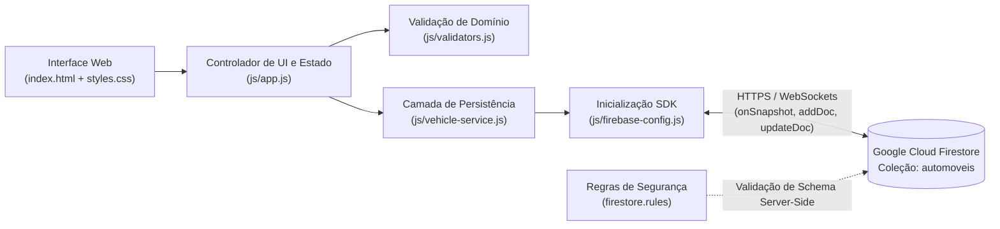

# 🚗 AutoFleet — Sistema Web de Gestão e Manutenção de Automóveis

[](https://autofleet-veiculos.vercel.app/)
[](https://firebase.google.com/docs/firestore)
[](https://developer.mozilla.org/pt-BR/docs/Web/JavaScript/Guide/Modules)
[](https://autofleet-veiculos.vercel.app/)

Aplicação Web reativa em tempo real para **cadastro, listagem, manutenção (alteração) e exclusão de automóveis**, desenvolvida com **JavaScript Modular (ES6+)** em arquitetura de camadas e persistência em nuvem via **Google Firebase (Cloud Firestore)**.

🔗 **Acesse a aplicação em produção:** [https://autofleet-veiculos.vercel.app/](https://autofleet-veiculos.vercel.app/)  
📦 **Repositório oficial:** [https://github.com/WagnerxOliveira/autofleet-veiculos](https://github.com/WagnerxOliveira/autofleet-veiculos)

---

## 📌 Sumário

1. [Atendimento aos Requisitos do Projeto](#-1-atendimento-aos-requisitos-do-projeto)
2. [Diferenciais de Engenharia e Mercado](#-2-diferenciais-de-engenharia-e-mercado)
3. [Arquitetura e Fluxo de Dados](#-3-arquitetura-e-fluxo-de-dados)
4. [Estrutura de Diretórios](#-4-estrutura-de-diretórios)
5. [Modelagem do Banco de Dados (NoSQL)](#-5-modelagem-do-banco-de-dados-nosql)
6. [Segurança e Validação de Domínio](#-6-segurança-e-validação-de-domínio)
7. [Como Executar Localmente no VS Code](#-7-como-executar-localmente-no-vs-code)
8. [Roteiro de Testes Funcionais (QA)](#-8-roteiro-de-testes-funcionais-qa)
9. [Deploy Contínuo (CI/CD)](#-9-deploy-contínuo-cicd)
10. [Equipe e Autoria](#-10-equipe-e-autoria)

---

## ✅ 1. Atendimento aos Requisitos do Projeto

A tabela abaixo relaciona cada exigência especificada na disciplina com a implementação técnica entregue:

| Requisito Especificado                    |    Status    | Implementação Técnica no Projeto                                                               |
| :---------------------------------------- | :----------: | :--------------------------------------------------------------------------------------------- |
| **Cadastrar automóvel no banco de dados** | ✅ Concluído | Função `createVehicle()` (`js/vehicle-service.js`) utilizando `addDoc` e `serverTimestamp()`.  |
| **Persistir: Marca do automóvel**         | ✅ Concluído | Campo `marca` (`string`, higienizado, validado entre 2 e 50 caracteres).                       |
| **Persistir: Modelo**                     | ✅ Concluído | Campo `modelo` (`string`, higienizado, validado entre 1 e 60 caracteres).                      |
| **Persistir: Cor**                        | ✅ Concluído | Campo `cor` (`string`, validado + indicador cromático dinâmico na tabela).                     |
| **Persistir: Placa**                      | ✅ Concluído | Campo `placa` (`string`, normalização canônica e suporte aos padrões Mercosul e Antigo).       |
| **Persistir: Ano de fabricação**          | ✅ Concluído | Campo `anoFabricacao` (`number` inteiro, validado entre `1900` e `anoAtual + 1`).              |
| **Persistir: Km rodada**                  | ✅ Concluído | Campo `kmRodada` (`number` inteiro `>= 0`, suportando veículos `0 km`).                        |
| **Listar todos os carros cadastrados**    | ✅ Concluído | Sincronização em tempo real via `onSnapshot` (`subscribeToVehicles`), sem recarregar a página. |
| **Alterar um automóvel já cadastrado**    | ✅ Concluído | Modo de edição dedicado (`enterEditMode` + `updateVehicle` via `updateDoc`).                   |
| **Uso da plataforma Firebase**            | ✅ Concluído | SDK Modular v12.11.0 (`firebase-app` e `firebase-firestore`) + regras `firestore.rules`.       |

---

## 🚀 2. Diferenciais de Engenharia e Mercado

Além do escopo obrigatório, a solução incorpora práticas modernas de desenvolvimento de software e qualidade:

- **Sincronização Reativa Multi-Usuário (`Realtime Listener`):** Qualquer inclusão, edição ou remoção reflete instantaneamente na tela de todos os usuários conectados por meio de WebSockets gerenciados pelo `onSnapshot` do Cloud Firestore.
- **Prevenção de Duplicidade de Placas:** Antes de inserir ou atualizar um veículo, o serviço executa uma query de verificação (`ensureUniquePlate`), impedindo duas entradas com a mesma placa (mesmo que digitadas com ou sem hífen) e ignorando o próprio ID durante edições.
- **Componente Visual de Placas Brasileiras:** Identificação automática e renderização fiel tanto do padrão **Mercosul (`ABC1D23`)** com tarja azul superior quanto do padrão **Cinza Legado (`ABC-1234`)**.
- **Indicadores de Frota (KPIs em Tempo Real):** Cálculo automático do total de veículos registrados, média de quilometragem da frota e ano de fabricação mais recente.
- **Busca Instantânea e Ordenação Multicritério:** Filtro textual em tempo real (marca, modelo, placa, cor ou ano) combinado com ordenação por data de cadastro, ano de fabricação, menor/maior quilometragem ou ordem alfabética.
- **Exclusão Segura com Confirmação Modal:** Operação complementar de remoção (`deleteDoc`) protegida por modal de confirmação e tratamento contra exclusão concorrente caso um registro em edição seja apagado por outro integrante.

---

## 🏗️ 3. Arquitetura e Fluxo de Dados

O projeto adota **Arquitetura em Camadas com Separação de Responsabilidades (SoC)** baseada em **ES6 Modules** nativos do navegador, dispensando _bundlers_ complexos e mantendo o código limpo e testável:



---

## 📂 4. Estrutura de Diretórios

```text
autofleet-veiculos/
├── index.html              # Estrutura semântica, formulário, KPIs, tabela e modal
├── firestore.rules         # Regras de segurança e validação de dados no Cloud Firestore
├── .vercelignore           # Impede a exposição pública do arquivo firestore.rules no deploy
├── README.md               # Documentação técnica e guia de execução do projeto
├── css/
│   └── styles.css          # Design System responsivo (CSS Custom Properties, Grid e Flexbox)
└── js/
    ├── firebase-config.js  # Configuração e instância modular do Firebase / Cloud Firestore
    ├── validators.js       # Sanitização de strings, regex de placas e regras de negócio
    ├── vehicle-service.js  # Operações assíncronas CRUD e listener em tempo real (Firestore)
    └── app.js              # Gerenciamento de estado da UI, eventos, filtros e renderização segura
```

---

## 🗄️ 5. Modelagem do Banco de Dados (NoSQL)

Os registros são armazenados no **Cloud Firestore** (região `southamerica-east1` — São Paulo) dentro da coleção **`automoveis`**. Cada documento possui ID único gerado automaticamente e segue o contrato abaixo:

| Campo           | Tipo no Firestore | Obrigatório | Regra de Domínio                                                        | Exemplo               |
| :-------------- | :---------------: | :---------: | :---------------------------------------------------------------------- | :-------------------- |
| `marca`         |     `string`      |     Sim     | 2 a 50 caracteres                                                       | `"Toyota"`            |
| `modelo`        |     `string`      |     Sim     | 1 a 60 caracteres                                                       | `"Corolla Altis 2.0"` |
| `cor`           |     `string`      |     Sim     | 3 a 30 caracteres                                                       | `"Prata"`             |
| `placa`         |     `string`      |     Sim     | 7 caracteres alfanuméricos (`^[A-Z]{3}([0-9]{4}\|[0-9][A-Z][0-9]{2})$`) | `"ABC1D23"`           |
| `anoFabricacao` |     `number`      |     Sim     | Inteiro entre `1900` e `anoAtual + 1`                                   | `2024`                |
| `kmRodada`      |     `number`      |     Sim     | Inteiro entre `0` e `9999999`                                           | `32500`               |
| `criadoEm`      |    `timestamp`    | Automático  | Gerado no servidor via `serverTimestamp()` na criação                   | `Timestamp(...)`      |
| `atualizadoEm`  |    `timestamp`    | Automático  | Atualizado via `serverTimestamp()` na criação e edição                  | `Timestamp(...)`      |

### Exemplo de Documento Persistido

```json
{
  "marca": "Volkswagen",
  "modelo": "Nivus Highline 200 TSI",
  "cor": "Cinza",
  "placa": "BRA2E19",
  "anoFabricacao": 2025,
  "kmRodada": 14200,
  "criadoEm": "2026-11-20T22:30:00.000Z",
  "atualizadoEm": "2026-11-20T22:35:12.000Z"
}
```

---

## 🛡️ 6. Segurança e Validação de Domínio

1. **Mitigação Total contra XSS (Cross-Site Scripting):** Toda a renderização dinâmica da tabela em `js/app.js` utiliza exclusivamente criação segura de nós da DOM API (`document.createElement` e `element.textContent`), impedindo injeção de scripts maliciosos via campos de texto.
2. **Dupla Camada de Validação (Client-Side + Server-Side):**
   - **No Front-end (`js/validators.js`):** Higieniza espaços excedentes, normaliza placas removendo hifens para armazenamento canônico e exibe mensagens de erro específicas por campo.
   - **No Back-end (`firestore.rules`):** Mesmo que alguém tente enviar requisições diretas à API do Firebase fora da interface Web, as _Security Rules_ bloqueiam qualquer gravação cujo payload não respeite os tipos, tamanhos e expressões regulares exigidos.

---

## 💻 7. Como Executar Localmente no VS Code

Por utilizar **ES6 Modules** nativos (`<script type="module">`), os navegadores exigem execução sob protocolo HTTP/HTTPS (não abra diretamente via `file://`).

1. **Clone o repositório:**

   ```powershell
   git clone [https://github.com/WagnerxOliveira/autofleet-veiculos.git](https://github.com/WagnerxOliveira/autofleet-veiculos.git)
   cd autofleet-veiculos
   ```

2. **Inicie um servidor estático local no terminal do VS Code:**

   ```powershell
   npx serve .
   ```

   _(Alternativamente, utilize a extensão **Live Server** do VS Code clicando com o botão direito em `index.html` > **Open with Live Server**)._

3. **Acesse no navegador:**
   Abra `http://localhost:3000` (ou a porta indicada no terminal) e verifique o selo verde **Firestore Sincronizado** no canto superior direito.

---

## 🧪 8. Roteiro de Testes Funcionais (QA)

Roteiro estruturado para validação completa em produção ([https://autofleet-veiculos.vercel.app/](https://autofleet-veiculos.vercel.app/)):

| ID        | Caso de Teste                        | Dados de Entrada / Ação                                                                                                | Resultado Esperado                                                                                                        |
| :-------- | :----------------------------------- | :--------------------------------------------------------------------------------------------------------------------- | :------------------------------------------------------------------------------------------------------------------------ |
| **CT-01** | Cadastro com Placa Mercosul          | Marca: `Toyota`, Modelo: `Corolla`, Placa: `ABC1D23`, Cor: `Prata`, Ano: `2024`, Km: `15000`                           | Veículo salvo no Firestore, exibido instantaneamente na tabela com placa padrão Mercosul e KPIs atualizados.              |
| **CT-02** | Cadastro Veículo 0 km e Placa Antiga | Marca: `Fiat`, Modelo: `Pulse`, Placa: `XYZ-9876`, Cor: `Branco`, Ano: `2026`, Km: `0`                                 | Hífen normalizado no banco (`XYZ9876`), exibição formatada como `XYZ-9876` (tarja cinza) e aceitação válida de `0 km`.    |
| **CT-03** | Bloqueio de Placa Duplicada          | Tentar cadastrar novo veículo com a placa `ABC1D23` já existente                                                       | Sistema bloqueia a gravação e exibe notificação informando que já existe automóvel com essa placa.                        |
| **CT-04** | Alteração de Automóvel Cadastrado    | Clicar em **Editar** no veículo `ABC1D23`, alterar Km para `18500` e Cor para `Preto`, clicar em **Salvar Alterações** | Documento atualizado no Firestore, linha atualizada em tempo real na listagem e retorno do formulário ao modo de criação. |
| **CT-05** | Validação de Campos Inválidos        | Submeter formulário vazio ou com Ano `1850` / Km negativa                                                              | Submissão impedida no cliente com destaque visual nos campos inválidos e mensagens orientativas abaixo de cada input.     |
| **CT-06** | Persistência após Reload             | Pressionar `F5` no navegador                                                                                           | Todos os registros permanecem carregados diretamente do Cloud Firestore.                                                  |

---

## 🌐 9. Deploy Contínuo (CI/CD)

A aplicação está integrada via GitHub à plataforma **Vercel**:

- Cada `git push` na branch `main` dispara automaticamente uma nova publicação em produção em **[https://autofleet-veiculos.vercel.app/](https://autofleet-veiculos.vercel.app/)**.
- O arquivo `.vercelignore` garante que o arquivo de infraestrutura `firestore.rules` permaneça versionado no GitHub para auditoria acadêmica sem ser servido publicamente na CDN.

---

## 👨‍💻 10. Equipe e Autoria

Projeto final desenvolvido para a disciplina de Desenvolvimento de Aplicações Web:

- **Wagner Oliveira** — [@WagnerxOliveira](https://github.com/WagnerxOliveira)
